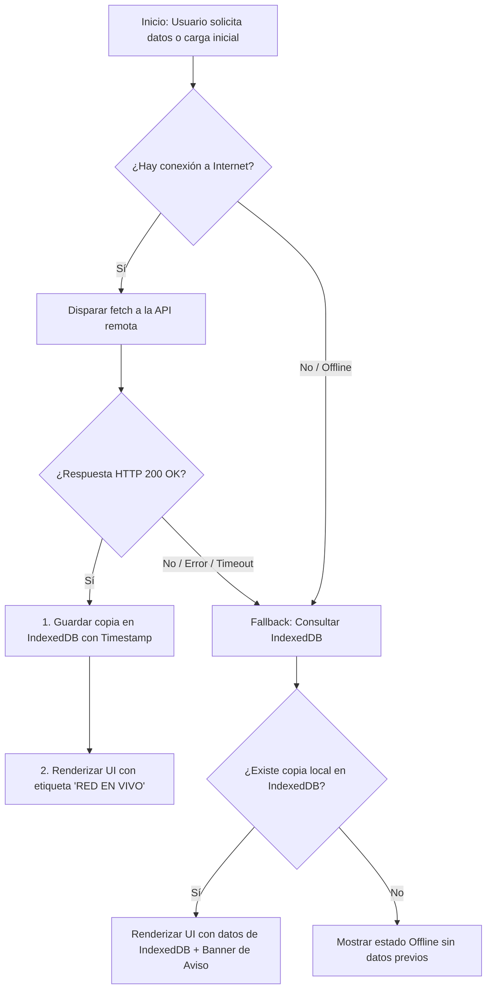

# Actividad 5: Estrategia de Caché Dinámica con Fallback a IndexedDB (Network-First)

Aplicación web interactiva que implementa estrategias modernas de almacenamiento en caché dinámica (**Network-First** y **Stale-While-Revalidate**) consumiendo APIs REST remotas mediante `fetch`. Cuando se recibe una respuesta exitosa, los datos se persisten de forma estructurada en **IndexedDB nativo**; si el dispositivo pierde la conexión o el servidor remoto falla, la interfaz recupera y renderiza automáticamente la última copia local preservada.

---

## 🎯 Objetivos de la Actividad

1. **Consumo de APIs REST remotas con `fetch`**:
   - Integración con endpoints reales (`JSONPlaceholder`, `DummyJSON`) y mock local.
   - Manejo de tiempos de espera con `AbortController`.
2. **Estrategia Network-First con Fallback Automático**:
   - Priorizar siempre la red en vivo.
   - En caso de fallo (`TypeError: Failed to fetch`, timeout o error de servidor), consultar automáticamente el almacén local en **IndexedDB** y renderizar los datos respaldados con aviso visual.
3. **Estrategia Stale-While-Revalidate**:
   - Renderizar de forma inmediata los datos de la caché local de IndexedDB para eliminar la latencia percibida.
   - Realizar una petición a la red en segundo plano para revalidar, actualizar la vista y sincronizar la base de datos.
4. **Persistencia Estructurada en IndexedDB**:
   - Base de datos: `DynamicCacheDB`.
   - Object Store: `api_cache_store` con clave primaria `endpoint`.
   - Índices secundarios: `by_timestamp`, `by_strategy` y `by_status`.
5. **Detección Reactiva de Red**:
   - Escucha de eventos nativos `window.addEventListener('online')` y `window.addEventListener('offline')`.
   - **Simulador de Fallas Integrado**: Permite forzar el modo offline o simular errores HTTP 500 con un interruptor sin necesidad de apagar la tarjeta de red.

---

## 🔄 Arquitectura y Flujo de la Estrategia Network-First



---

## 📂 Estructura del Proyecto (`Act.-5`)

```
Act.-5/
├── index.html       # Estructura semántica, consola de estrategias, telemetría y modal inspector
├── style.css        # Sistema de diseño dark glassmorphic, microanimaciones y responsividad
├── script.js        # Lógica de IndexedDB nativo, estrategias de caché, fetch y simulador
├── server.js        # Servidor local Node.js nativo (puerto 3005) con endpoint /api/articles
└── README.md        # Documentación técnica, casos de prueba y guía de uso
```

---

## 🚀 Puesta en Marcha

### Opción 1: Con Servidor Node.js (Recomendado)
Abre una terminal en la carpeta `Act.-5` y ejecuta:

```bash
node server.js
```

Luego abre tu navegador en:
👉 **`http://localhost:3005`**

### Opción 2: Apertura Directa en el Navegador
También puedes abrir el archivo `index.html` con la extensión **Live Server** de VS Code o haciendo doble clic sobre él.

---

## 🧪 Guía de Pruebas y Verificación

### Caso 1: Flujo en Línea Normal (Network-First)
1. Con la opción **"Network-First"** seleccionada y el interruptor offline desactivado, haz clic en **"Ejecutar Petición (Fetch)"**.
2. Observa cómo la telemetría indica:
   - Origen: `🌐 Red Remota (En Vivo)`
   - Latencia: (ej. `120 ms` / HTTP 200)
   - IndexedDB: `1 endpoint en caché`
3. Se renderizan las tarjetas y aparece un Toast verde de confirmación.

### Caso 2: Simulación de Desconexión (Fallback Automático a IndexedDB)
1. Activa el interruptor **"Simular Modo Offline"** en la consola de control (o desconecta tu Wi-Fi).
2. El indicador de red cambiará a `Offline (Simulado)` en rojo.
3. Haz clic en **"Ejecutar Petición (Fetch)"**.
4. **Resultado esperado:**
   - La petición a la red no se ejecuta o falla.
   - La aplicación detecta el fallo y **automáticamente recupera el último JSON guardado en IndexedDB**.
   - Aparece el banner amarillo de alerta: *"¡Modo Fallback Offline Activado! Se renderizó automáticamente la última copia local..."*.
   - El badge de origen cambia a: `ORIGEN: CACHÉ INDEXEDDB (FALLBACK)`.

### Caso 3: Prueba de Stale-While-Revalidate
1. Selecciona la estrategia **"Stale-While-Revalidate"**.
2. Haz clic en **"Ejecutar Petición (Fetch)"**.
3. Observa cómo los datos cacheados aparecen instantáneamente en 0ms y posteriormente la interfaz revalida con la red mostrando el badge violeta de actualización.

### Caso 4: Inspector Visual de IndexedDB
1. Haz clic en el botón **"Inspeccionar IndexedDB"**.
2. Se abrirá una ventana modal que muestra:
   - Lista de endpoints almacenados con fecha, cantidad de items y tamaño en KB.
   - Visor de JSON crudo con opción de copiar al portapapeles.
   - Opción para eliminar registros individuales o vaciar el almacén completo.

---

## 🛠️ Tecnologías Empleadas
- **HTML5**: Semántica accesible (`<header>`, `<main>`, `<section>`, `<article>`).
- **CSS3**: Variables CSS, Glassmorphism, Gradientes, CSS Grid y Flexbox.
- **JavaScript Moderno (ES6+)**:
  - `fetch` con promesas asíncronas (`async/await`).
  - `indexedDB` nativo con transacciones y Object Stores.
  - `AbortController` para control de timeouts.
  - Eventos de red `window.ononline` y `window.onoffline`.
- **Node.js**: Servidor HTTP nativo sin dependencias externas.
